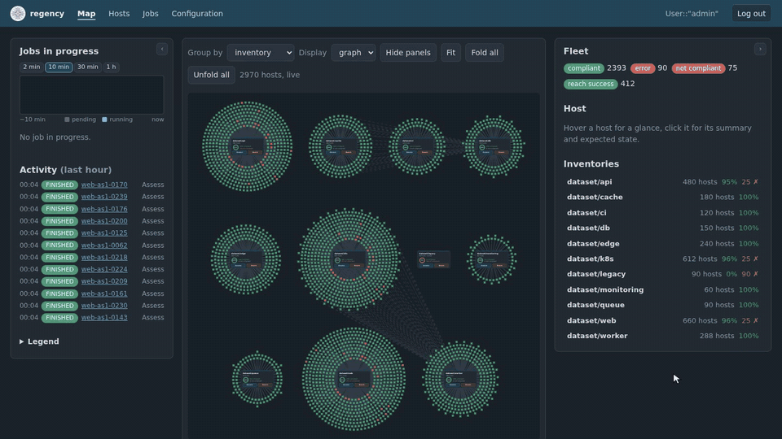
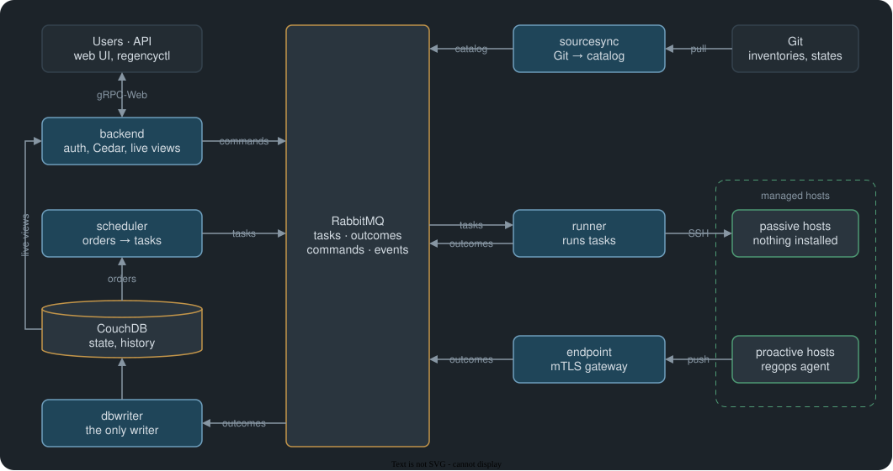

  
  <h1>regency</h1>
  
<em>Configuration management for thousands of hosts, live.</em>

  
  
  

  

regency is the fleet-scale control plane of
[regent-sdk](https://github.com/regent-project/regent-sdk): describe what your
hosts should look like, and regency checks them (**Assess**), fixes them
(**Reach**), records every outcome and shows the whole fleet live.

## Architecture

Every service is stateless and runs as many replicas as needed: no single
point of failure.

## Documentation

Everything else (concepts, deployment, operations, reference) is in
**[the book](https://regent-project.github.io/regency/)**.

## Community and contributing

Questions, ideas and feedback: join us on
**[Discord](https://discord.gg/2gxAW7uzsx)**.

Contributions are welcome: open an
[issue](https://github.com/regent-project/regency/issues) to discuss a change,
then a pull request. [Development](book/src/project/development.md) explains
how to build, test and run the whole stack locally (`dev/run_locally`).
